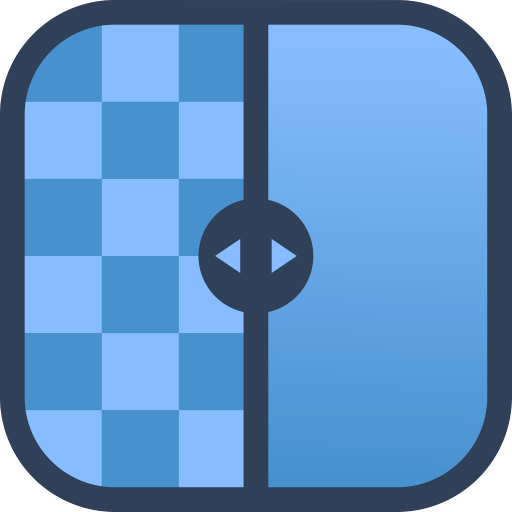

# Upscayl Mobile

**Portage non officiel d'Upscayl pour iOS et Android**

Agrandis et améliore tes images avec l'IA, directement sur ton téléphone.

---

## :arrow_down: Téléchargement

Les liens ci-dessous pointent toujours vers **la dernière version** : ils ne changent jamais.

| Plateforme | Lien direct | Configuration |
|---|---|---|
| :robot: **Android** | [Upscayl-Android.apk](https://github.com/akuuvfx/upscayl-ios/releases/download/latest/Upscayl-Android.apk) | Android 10 ou plus, processeur 64 bits |
| :apple: **iOS** | [Upscayl.ipa](https://github.com/akuuvfx/upscayl-ios/releases/download/latest/Upscayl.ipa) | iOS 16 ou plus |

### Installation

**Android**
1. Ouvre le lien sur ton téléphone et télécharge l'APK.
2. Autorise l'installation depuis cette source si Android le demande.
3. Ouvre le fichier et installe.

**iOS** : le fichier n'est pas signé, il s'installe par sideloading depuis un ordinateur avec [Sideloadly](https://sideloadly.io) ou [AltStore](https://altstore.io).

---

## :sparkles: Fonctionnalités

- Agrandissement ×2, ×3 et ×4
- Plusieurs modèles d'IA (photos, illustrations, mode rapide…)
- Comparaison avant / après avec curseur
- Enregistrement dans la galerie et partage
- Interface en verre translucide, légère
- Application en **français** ou en **anglais** (au choix dans l'onglet « À propos »)

---

## :warning: Crédits et avertissement

Ce projet est un **portage mobile non officiel d'Upscayl**, réalisé indépendamment de l'équipe originale.

L'ensemble des droits, du travail original, des marques et des ressources appartient à leurs créateurs et ayants droit respectifs. Tous les crédits reviennent aux développeurs et contributeurs originaux d'Upscayl.

Ce projet **n'est ni affilié, ni approuvé, ni soutenu officiellement par l'équipe d'Upscayl**.

Ce portage est un projet communautaire indépendant. Nous ne revendiquons aucun droit sur le projet original : tout le mérite revient aux personnes qui l'ont créé et développé.

:link: **Projet officiel :** https://github.com/upscayl/upscayl

Merci aux développeurs originaux pour leur travail !

---

## :page_facing_up: Licences

- Upscayl : AGPL-3.0 (voir [`LICENSE`](LICENSE))
- Real-ESRGAN : BSD-3-Clause (voir [`Real-ESRGAN_LICENSE.txt`](Real-ESRGAN_LICENSE.txt))
- ncnn : BSD-3-Clause

Portage réalisé par **Akuu**, qui ne détient aucun droit sur le projet original.

Pour les développeurs

| Plateforme | Dossier | Moteur | Workflow |
|---|---|---|---|
| iOS | racine (`Sources/`, `project.yml`) | Real-ESRGAN converti en Core ML | `build-ipa.yml` |
| Android | `android/` | modèles ncnn d'Upscayl (Vulkan, repli CPU) | `build-apk.yml` |

Chaque `git push` lance le build correspondant sur GitHub Actions et remplace le fichier de la release `latest`.

